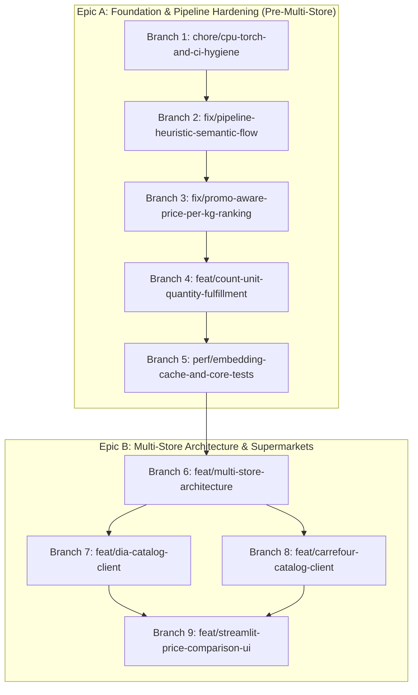

# ROADMAP — Architecture Audit, Local Guide & Multi-Store Plan

This document consolidates a full technical review of `record-linkage-supermarket-online` (`supermarket_linkage`), instructions for running and inspecting the repository locally, an assessment of unit and integration test coverage, and a 9-branch execution plan to harden v1 (Mercadona) and extend to v2 (multi-store price comparison across Mercadona, DIA, and Carrefour).

---

## 1. How to Run and Inspect the Repository Locally

The project splits responsibilities across two processes ([`DESIGN.md §4`](DESIGN.md#L46-L54)):

| Process | Entrypoint | Port (Local / Compose) | Responsibilities |
|---|---|---|---|
| **Worker** (FastAPI) | `supermarket_linkage.worker.api:app` | `8000` (host) / `7860` (container) | Catalog fetching, embedding generation, 4-stage linkage pipeline, `/health`, `/warmup`, `/jobs`, OpenAPI Swagger UI (`/docs`) |
| **Master** (Streamlit) | `src/supermarket_linkage/app/streamlit_app.py` | `8501` | Shopping-list UI, input validation, job submission/polling, CSV/link exports |

The Streamlit process never loads the embedding model and never calls supermarket APIs directly.

### Step 0 — Environment Setup (`uv`)

```bash
uv sync --extra dev
cp .env.example .env   # if .env does not exist yet
```

Verify `.env` contains matching credentials and local worker URL:

```dotenv
WORKER_URL=http://localhost:8000
WORKER_API_KEY=change-me-to-a-random-string
DEFAULT_WAREHOUSE=mad1
USE_SAMPLE_CATALOG=1
```

---

### Option A — Sample Mode (Fastest, 100% Offline)

Uses `tests/fixtures/sample_catalog.json` (~40 products) and `TokenOverlapEmbedder`. No ~100 MB MiniLM download and no external HTTP calls to Mercadona.

1. **Terminal 1 — Start the FastAPI Worker:**
   ```bash
   USE_SAMPLE_CATALOG=1 uv run --env-file .env uvicorn supermarket_linkage.worker.api:app --host 0.0.0.0 --port 8000 --reload
   ```
   - Health check: <http://localhost:8000/health>
   - Interactive Swagger API docs: <http://localhost:8000/docs>

2. **Terminal 2 — Start the Streamlit Master UI:**
   ```bash
   uv run --env-file .env streamlit run src/supermarket_linkage/app/streamlit_app.py
   ```
   - Open <http://localhost:8501> in your browser.
   - Enter any 5-digit Spanish postal code (e.g. `28001`) and paste items that match `tests/fixtures/sample_catalog.json`:
     ```text
     arroz basmati 1500 g
     leche entera 1l
     huevos camperos
     aceite de oliva virgen extra 1l
     queso fresco batido 2 paquetes
     ```

---

### Option B — Live Mode (Real Mercadona Algolia + MiniLM Embeddings)

Queries Mercadona's live Algolia API and downloads/loads `paraphrase-multilingual-MiniLM-L12-v2` (~100 MB on first run):

1. **Terminal 1 — Start the FastAPI Worker in live mode:**
   ```bash
   USE_SAMPLE_CATALOG=0 uv run --env-file .env uvicorn supermarket_linkage.worker.api:app --host 0.0.0.0 --port 8000
   ```
2. **Terminal 2 — Start the Streamlit Master UI:**
   ```bash
   uv run --env-file .env streamlit run src/supermarket_linkage/app/streamlit_app.py
   ```

---

### Option C — Docker Compose (Full Containerized Stack)

Uses `Dockerfile.worker` (CPU-only PyTorch) and `Dockerfile.streamlit` as configured in `docker-compose.yml`.

```bash
# Sample mode (default when USE_SAMPLE_CATALOG=1 in .env)
docker compose up --build

# Or Live Mercadona + MiniLM mode (first boot may take ~90 s for model download)
USE_SAMPLE_CATALOG=0 docker compose up --build
```

- **Streamlit UI:** <http://localhost:8501>
- **Worker API / Swagger UI:** <http://localhost:8000/docs>

---

### Option D — CLI Matching Debugger (`scripts/debug_match.py`)

Queries Mercadona Algolia directly and prints expanded search alternatives, raw hits, normalized names, `heuristic_pass`, and Jaro-Winkler distance per hit:

```bash
uv run python scripts/debug_match.py "arroz basmati 1500 g" "leche o bebida vegetal 6l" --warehouse mad1
```

---

### Running Tests & Coverage Locally

```bash
# Full offline suite (unit + integration + latency benchmarks; skips live HTTP)
uv run pytest -m "not live" -q

# Opt-in live Algolia smoke test (single query; do not loop)
RUN_LIVE_MERCADONA=1 uv run pytest tests/integration/test_mercadona_live_smoke.py -s -v

# Coverage report (after adding pytest-cov in Branch 1)
uv run pytest -m "not live" --cov=supermarket_linkage --cov-report=term-missing
```

---

## 2. Technical Audit — Improvements to What You Already Have

### 2.1 `[Priority 1 - Bug]` `HeuristicStage` drops `heuristic_pass == False` rows, making `SemanticStage` and `DistanceStage` filtering dead code

- **Where:**
  - `src/supermarket_linkage/pipeline/heuristic_stage.py` (lines 86–88)
  - `src/supermarket_linkage/pipeline/semantic_stage.py` (lines 131–135)
  - `src/supermarket_linkage/pipeline/distance_stage.py` (lines 78–82)
  - `src/supermarket_linkage/pipeline/linkage_orchestrator.py` (lines 28–45)
- **Root cause:**
  - `HeuristicStage._process` ends with `.filter(pl.col(CandidateColumns.HEURISTIC_PASS))`, immediately discarding every candidate where `heuristic_pass` is `False`.
  - `SemanticStage._process` filters using `above | (pl.col(CandidateColumns.HEURISTIC_PASS) == True)`.
  - `DistanceStage._process` filters using `close | (pl.col(CandidateColumns.HEURISTIC_PASS) == True)`.
  - Because `HeuristicStage` already dropped all `False` rows before Stage 2/3/4 ever run, **every row entering `SemanticStage` and `DistanceStage` already has `heuristic_pass == True`**. Consequently, MiniLM semantic thresholding (`>= 0.75`) and Jaro-Winkler filtering (`< 0.1`) never filter out a single candidate in `LinkageOrchestrator`, and a synonym/variant that fails exact token-subset matching can never be rescued by semantic similarity.
  - Additionally, `select_winner()` only sorts by `[price_per_kg, jw_similarity]` (Branch A) or `jw_similarity` (Branch B) and ignores `semantic_score` as a tie-breaker.
- **Fix:**
  - Have `HeuristicStage._process` populate `heuristic_pass` (`True`/`False`) **without** dropping `False` rows, so non-heuristic candidates pass through `BlockingStage` and are gated by `SemanticStage` (`>= 0.75`) and `DistanceStage` (`< 0.1`) as specified in `DESIGN.md §6`.
  - Add `semantic_score` as a secondary tie-breaker in `select_winner()`.

### 2.2 `[Priority 1 - Bug]` Promo prices are applied *after* winner selection and distort `price_per_kg`

- **Where:**
  - `src/supermarket_linkage/catalog/mercadona_client.py` (lines 85–99)
  - `src/supermarket_linkage/preprocessors/price_normalizer.py` (lines 48–73)
  - `src/supermarket_linkage/worker/job_orchestrator.py` (lines 185–196)
- **Root cause (two-sided inconsistency):**
  1. When a Mercadona product has `price_decreased=True` (see `tests/fixtures/mercadona_search_response.json`, hit `30902`), `unit_price` (`0.75`) and `reference_price` (`0.750`) already reflect the **promo** price, while `previous_unit_price` (`0.84`) is the regular price. `PriceNormalizer` unconditionally copies `unit_price_eur` (`reference_price`) into `price_per_kg` (`0.75`), even when `is_promo_member=False`.
  2. Conversely, for `UNIDAD` products with a weight parsed from the product title, `PriceNormalizer` computes `price_eur / weight_kg` using the regular price and ignores `promo_price_eur`, even when `is_promo_member=True`.
  3. In `JobOrchestrator._execute`, `_apply_promo` runs *after* `_link_line_with_alternatives` has already selected the winner via `select_winner()`.
- **Fix:**
  - Resolve effective payable price via `PromoPolicy` (`is_promo_member`) **before** `select_winner()`, and compute candidate `price_per_kg` consistently from that effective price so Branch A ranks candidates by what the user will actually pay.

### 2.3 `[Priority 1 - Feature Gap]` Count-based quantities (`"2 paquetes"`, `"24 unidades"`) always resolve to `units_needed = 1`

- **Where:**
  - `src/supermarket_linkage/preprocessors/text_normalizer.py` (lines 136–151)
  - `src/supermarket_linkage/preprocessors/quantity_resolver.py` (lines 17–28)
- **Root cause:**
  - `parse_requested_amount_kg` explicitly returns `None` whenever `is_count_unit(unit)` is `True` (`ud`, `uds`, `unidad`, `unidades`, `paquete`, `paquetes`, `pack`, `packs`).
  - `QuantityResolver` receives `requested_amount_kg=None` and `units_for_total_weight` immediately returns `(1, False)`.
  - As a result, a line such as `"Queso fresco batido 2 paquetes"` or `"Huevos camperos 24 unidades"` strips the quantity for search, then outputs `units_needed = 1`.
- **Fix:**
  - Extract requested count units (`parse_requested_count`) in `TextNormalizer` alongside `requested_amount_kg`.
  - In `QuantityResolver`, when `requested_amount_kg` is `None` and a requested count is present:
    - For pack/container requests (`paquete(s)`, `pack(s)`), fulfill directly as `requested_count` packs (`2 paquetes` → `units_needed = 2`).
    - For piece requests (`unidad(es)`, `ud(s)`), parse pack piece count from product name when available (e.g., `"Huevos camperos M 12 uds"` + `"24 unidades"` → `ceil(24 / 12) = 2`), or fall back to `requested_count` when pack count is 1/unknown (or flag if ambiguous).

### 2.4 `[Priority 2 - Packaging / DX]` Pin CPU-only PyTorch in `pyproject.toml`

- **Where:** `pyproject.toml` (lines 7–17) vs. `Dockerfile.worker` (lines 33–34)
- **Root cause:**
  - `Dockerfile.worker` installs CPU-only PyTorch from `https://download.pytorch.org/whl/cpu`.
  - However, `pyproject.toml` specifies `"torch>=2.0"` without an explicit CPU wheel index, so `uv sync --extra dev` on Linux (locally and in GitHub Actions) downloads ~2.5 GB of unused NVIDIA CUDA (`nvidia-*`, `triton`) packages.
- **Fix:** Add explicit `uv` index mapping in `pyproject.toml`:
  ```toml
  [tool.uv.sources]
  torch = { index = "pytorch-cpu", marker = "sys_platform == 'linux'" }

  [[tool.uv.index]]
  name = "pytorch-cpu"
  url = "https://download.pytorch.org/whl/cpu"
  explicit = true
  ```

### 2.5 `[Priority 2 - Performance]` Batch or cache embeddings across a job (`DESIGN.md §11.5`)

- **Where:**
  - `src/supermarket_linkage/worker/job_orchestrator.py` (lines 183–191)
  - `src/supermarket_linkage/worker/warmup.py`
  - `src/supermarket_linkage/pipeline/semantic_stage.py`
- **Root cause:**
  - `DESIGN.md §11` explicitly recommends *"Batch embeddings after all fetches"* to keep 50-line jobs within SLO on CPU Basic.
  - Currently, `JobOrchestrator._execute` loops line by line and `_link_line_with_alternatives` runs `SemanticStage` per alternative (up to 7 sequential search alternatives for generic `"pasta"` queries), encoding duplicate query/candidate strings repeatedly.
- **Fix:** Add an in-memory LRU/job-scoped embedding cache (or pre-encode all unique candidate/query strings once per job after `search_batch`) so each unique string is embedded at most once.

### 2.6 `[Priority 2 - Code Quality & CI]` Deduplicate helpers and promote Ruff in CI

- **Where:**
  - `.github/workflows/ci.yml` (line 54: `continue-on-error: true` on `lint`)
  - `src/supermarket_linkage/export/consts.py` (line 6 redefines `STATUS_NO_MATCH = "no_match"`, already defined in `src/supermarket_linkage/pipeline/consts.py`)
  - `tests/integration/test_pipeline_sample_catalog.py` (lines 28–48 duplicate `TokenOverlapEmbedder` from `src/supermarket_linkage/worker/warmup.py`)
- **Fix:** Remove the duplicate definitions, run `ruff check --fix` / `ruff format`, and remove `continue-on-error: true` in `.github/workflows/ci.yml` so lint/formatting checks are enforced.

---

## 3. Unit & Integration Test Coverage Assessment

### What Is Already Well Covered

Your test suite already has strong unit and benchmark coverage across 17 files in `tests/unit/`, 2 in `tests/integration/`, and 2 in `tests/benchmark/`:
- Text normalization, accent stripping, stemming, OR/pasta expansion (`test_text_normalizer.py`)
- Price normalization & quantity resolution edge cases (`test_price_normalizer.py`, `test_quantity_resolver.py`)
- Individual pipeline stages in isolation (`test_heuristic_stage.py`, `test_blocking_stage.py`, `test_semantic_stage.py`, `test_distance_stage.py`, `test_winner_selection.py`)
- Input validation, rate limiting, in-memory job TTL/copy isolation, promo policy, export builders (`test_input_validator.py`, `test_rate_limiter.py`, `test_job_store.py`, `test_promo_policy.py`, `test_export_builder.py`)
- FastAPI HTTP routes & auth (`test_worker_api.py`), latency SLO harness (`tests/benchmark/`)

Adding redundant happy-path tests to those modules has low marginal value.

### 5 High-ROI Coverage Gaps

| # | Area / Module | Current Blind Spot | High-Value Tests to Add |
|---|---|---|---|
| 1 | **Multi-stage pipeline integration** (`tests/integration/test_pipeline_sample_catalog.py`) | Every stage works in isolation, and every matched integration test passes `HeuristicStage`. The bug where `HeuristicStage` drops `False` rows before `SemanticStage` was never caught. | End-to-end `LinkageOrchestrator` test where a query fails `heuristic_pass` (`False`) but succeeds via `SemanticStage` (`>= 0.75`) + `DistanceStage` (`< 0.1`). |
| 2 | **`JobOrchestrator.run()` lifecycle** (`tests/unit/test_job_orchestrator_helpers.py`) | Only module helper functions are tested directly; `run()` error paths are untested. | Unit tests for `JobOrchestrator.run()` covering: (a) `JobTimeoutError` → `STATUS_TIMEOUT`, (b) catalog/embedder exception → `STATUS_ERROR` + `rate_limiter.release_job(ip)` still runs, (c) `is_promo_member=True` vs `False` flipping the winning SKU. |
| 3 | **Master HTTP client & config** (`src/supermarket_linkage/app/worker_client.py`, `exceptions.py`, `master_config.py`) | Only `_health_poll_interval` (12 lines in `test_health_poll_interval.py`) is tested in `app/`. | `pytest-httpx` tests for `WorkerClient` (`ConnectError`, `TimeoutException`, HTTP 401/404/429/500 Spanish UX mapping in `_error_message`), `start_warmup_once` deduplication/cooldown, and `load_master_config` `.env` loading. *(Wait to test store-selection payloads until multi-store API schema is finalized in Branch 6.)* |
| 4 | **`MercadonaCatalogClient` resilience** (`tests/unit/test_mercadona_parser.py`) | Happy-path search and header-based postal lookup are covered, but fallbacks and chunking are not. | Unit tests for `_lookup_warehouse` on HTTP 4xx/5xx, malformed JSON, and JSON body fallback (`warehouse` / `wh` / `customer_wh`); `search_batch` chunking across `> 100` queries (`MERCADONA_SEARCH_BATCH_SIZE`); and `__enter__`/`__exit__` closing owned `httpx.Client`. |
| 5 | **`TableSchemaBase` & `ModelRegistry` edge cases** (`schemas/base.py`, `worker/warmup.py`) | Only tested indirectly. | Unit tests for `TableSchemaBase.get_column_index` (valid/invalid), `enforce_schema` (casting, adding missing columns, dropping unknown columns), and `ModelRegistry.get()` setting `last_error` + `/warmup` returning HTTP 500 on load failure. |

---

## 4. Sequencing Strategy — What to Do Before vs. During Multi-Store (DIA / Carrefour)

**Do ~70% of the cleanup before multi-store (Epic A), and fold ~30% directly into the multi-store refactor (Epic B).**

### Why Epic A Must Come First
1. **Multi-store amplifies pipeline bugs across $N$ stores:** Cross-supermarket price comparison multiplies any matching or price/kg bug across Mercadona, DIA, and Carrefour.
2. **DIA and Carrefour titles rely on semantic fallback:** Current heuristic aliases and prefix rules (`TOKEN_ALIASES`, `NAME_FORMAT_PREFIXES`) are tuned to Mercadona's catalog titles. Until `HeuristicStage` stops dropping non-heuristic candidates, DIA/Carrefour synonyms cannot match via MiniLM.
3. **Fair price comparison requires promo-aware `price_per_kg` and count quantities:** Club pricing (*Club DIA*, *El Club Carrefour*) and multi-pack formats are core to comparing baskets fairly across chains.
4. **3× catalog volume needs embedding caching:** Querying 3 supermarkets multiplies candidate titles per job. Caching/batching embeddings first keeps CPU latency predictable.

### What Should Wait for Epic B (Multi-Store)
1. **Store-specific vocabulary (`TOKEN_ALIASES`):** `normalize_text` currently rewrites `"boniato"` → `"batata"` globally because Mercadona uses *batata*. DIA/Carrefour may use *boniato*. Moving store synonyms into `extract_search_alternatives` (instead of destructive normalization) should happen in Branch 6 alongside multi-store search.
2. **Export & UI refactoring:** `streamlit_consts.py` hardcodes `_EXPORT = MercadonaExportBuilder()` and `streamlit_app.py` hardcodes `validate=r"^https://tienda\.mercadona\.es/.*"`. Replace these with an `ExportBuilderFactory` and multi-store comparison views during Branches 6–9 rather than refactoring single-store UI code twice.
3. **Store-selection API & `WorkerClient` payload tests:** Wait until `POST /jobs` evolves from `store: str` to multi-store (`stores: list[str]`) before writing detailed client/API store-validation tests.

---

## 5. Branch-by-Branch Execution Plan (9 Feature Branches)



---

### Epic A — Foundation & v1 Hardening

#### Branch 1: `chore/cpu-torch-and-ci-hygiene`
- **Goal:** Switch `uv` Linux installs to CPU-only PyTorch, add coverage tooling, clean up minor duplication, and enforce Ruff in CI.
- **Files to modify:**
  - `pyproject.toml`: Configure `pytorch-cpu` index in `[[tool.uv.index]]` and `[tool.uv.sources]` for `torch`; add `pytest-cov` to `[project.optional-dependencies].dev`.
  - `src/supermarket_linkage/export/consts.py`: Import `STATUS_NO_MATCH` from `supermarket_linkage.pipeline.consts` instead of redefining it.
  - `tests/integration/test_pipeline_sample_catalog.py`: Import and use `TokenOverlapEmbedder` from `supermarket_linkage.worker.warmup`.
  - `.github/workflows/ci.yml`: Fix Ruff warnings/formatting across `src/` and `tests/`, and remove `continue-on-error: true` from the `lint` job.
- **Verification / Definition of Done:**
  - `uv sync --extra dev` installs `+cpu` torch wheel without CUDA dependencies.
  - `uv run ruff check src tests` and `uv run ruff format --check src tests` pass cleanly.
  - `uv run pytest -m "not live" --cov=supermarket_linkage` passes.

#### Branch 2: `fix/pipeline-heuristic-semantic-flow`
- **Goal:** Ensure `SemanticStage` and `DistanceStage` actually evaluate candidates that fail `HeuristicStage`, matching `DESIGN.md §6`.
- **Files to modify:**
  - `src/supermarket_linkage/pipeline/heuristic_stage.py`: In `HeuristicStage._process()`, compute and assign `CandidateColumns.HEURISTIC_PASS` without filtering out `False` rows.
  - `src/supermarket_linkage/pipeline/linkage_orchestrator.py`: Update `select_winner()` so `semantic_score` acts as a final tie-breaker after `price_per_kg` and `jw_similarity`.
- **Tests to add / update:**
  - `tests/unit/test_heuristic_stage.py`: Update `test_heuristic_stage_filters_and_flags` to assert both `True` and `False` rows are preserved and accurately flagged.
  - `tests/integration/test_pipeline_sample_catalog.py`: Add an integration test verifying a query with `heuristic_pass == False` passes through `SemanticStage` (`>= 0.75`) + `DistanceStage` (`< 0.1`) and matches.
- **Verification / Definition of Done:**
  - `uv run pytest -m "not live"` passes, including non-heuristic semantic matching.

#### Branch 3: `fix/promo-aware-price-per-kg-ranking`
- **Goal:** Evaluate `PromoPolicy` before winner selection and compute `price_per_kg` from the effective payable price (`is_promo_member`).
- **Files to modify:**
  - `src/supermarket_linkage/preprocessors/price_normalizer.py` & `src/supermarket_linkage/catalog/mercadona_client.py`: Distinguish regular `unit_price_eur` vs. promo `unit_price_eur` (when `price_decreased=True`) and support computing effective `price_per_kg` given `is_promo_member` and `PromoPolicy`.
  - `src/supermarket_linkage/pipeline/linkage_orchestrator.py`: Accept `promo_policy` and `is_promo_member` in `LinkageOrchestrator.link_line()` / `link_lines()` and apply effective pricing before `select_winner()`.
  - `src/supermarket_linkage/worker/job_orchestrator.py`: Pass `self._promo` and `spec.is_promo_member` into linkage instead of applying promo only post-hoc.
- **Tests to add / update:**
  - `tests/unit/test_price_normalizer.py`: Verify `price_per_kg` does not leak promo rates when `is_promo_member=False`, and includes `promo_price_eur` for `UNIDAD` packs when `is_promo_member=True`.
  - `tests/unit/test_winner_selection.py` & `tests/unit/test_worker_api.py`: Verify `is_promo_member=True` vs `False` can change the winning SKU when a promotion makes an item cheaper per kg.
- **Verification / Definition of Done:**
  - `uv run pytest -m "not live"` passes with promo ranking tests.

#### Branch 4: `feat/count-unit-quantity-fulfillment`
- **Goal:** Parse and fulfill count-based shopping-list quantities (`"2 paquetes"`, `"24 unidades"`, `"6 uds"`).
- **Files to modify:**
  - `src/supermarket_linkage/preprocessors/text_normalizer.py`: Add `parse_requested_count(text: str)` returning `(count, unit)` or normalized requested count when `is_count_unit(unit)` is true; include `requested_units` in `TextNormalizer._row_fields`.
  - `src/supermarket_linkage/preprocessors/quantity_resolver.py` & `src/supermarket_linkage/schemas/line_result_table.py`: When `requested_amount_kg` is `None` and `requested_units` is provided, compute `units_needed` (direct pack count for `paquete`/`pack`, or `ceil(requested / pack_units)` when pack count is parsed from product name for `unidad`/`ud`).
  - `src/supermarket_linkage/pipeline/linkage_orchestrator.py`: Forward `requested_units` into `link_line()` and `QuantityResolver`.
- **Tests to add / update:**
  - `tests/unit/test_text_normalizer.py`, `tests/unit/test_quantity_resolver.py`, `tests/integration/test_pipeline_sample_catalog.py`: Verify `"Queso fresco batido 2 paquetes"` resolves to `units_needed == 2` and `"huevos camperos 24 unidades"` vs. 12-unit pack resolves to `units_needed == 2`.
- **Verification / Definition of Done:**
  - `uv run pytest -m "not live"` passes and count quantities update `units_needed` and `line_total_price_eur`.

#### Branch 5: `perf/embedding-cache-and-core-tests`
- **Goal:** Avoid redundant embeddings across alternatives/jobs and close remaining backend test gaps before multi-store refactoring.
- **Files to modify:**
  - `src/supermarket_linkage/worker/warmup.py` & `src/supermarket_linkage/pipeline/semantic_stage.py`: Add job/LRU embedding caching around `Embedder.embed` (or pre-encode unique texts in `JobOrchestrator._execute`).
- **Tests to add:**
  - `tests/unit/test_job_orchestrator_helpers.py`: Test `JobOrchestrator.run()` timeout (`STATUS_TIMEOUT`), exception (`STATUS_ERROR`), and rate-limiter slot release.
  - `tests/unit/test_mercadona_parser.py`: Test `_lookup_warehouse` HTTP error/JSON body fallbacks, `search_batch` multi-chunking (`> 100` queries), and client context-manager cleanup.
  - `tests/unit/test_schemas_base.py`: Test `TableSchemaBase.get_column_index`, `enforce_schema`, and `as_empty_dataframe`.
  - `tests/unit/test_worker_client.py`: Test `WorkerClient` error mapping (`exceptions.py`), `start_warmup_once` cooldown, `load_master_config`, and `ModelRegistry` load failures (`HTTP 500` on `/warmup`).
- **Verification / Definition of Done:**
  - `uv run pytest -m "not live" --cov=supermarket_linkage --cov-report=term-missing` passes; latency benchmarks remain well within `DESIGN.md §10` mock caps.

---

### Epic B — Multi-Store Architecture & Price Comparison

#### Branch 6: `feat/multi-store-architecture`
- **Goal:** Make the pipeline, job API, and export layer store-agnostic across multiple stores per job.
- **Files to modify:**
  - `src/supermarket_linkage/preprocessors/text_normalizer.py`: Move Mercadona-specific `TOKEN_ALIASES` (e.g., `"boniato" ↔ "batata"`) out of destructive `normalize_text()` and into `extract_search_alternatives()` so DIA/Carrefour searches are not corrupted.
  - `src/supermarket_linkage/export/`: Add `ExportBuilderFactory.get(store)` (with `mercadona`, `dia`, `carrefour`) alongside `CatalogClientFactory` and a `PromoPolicyFactory`.
  - `src/supermarket_linkage/worker/api.py` & `src/supermarket_linkage/worker/job_orchestrator.py`: Extend `JobCreateBody` and `JobSpec` to support `stores: list[str]` (keeping `store: str` backwards-compatible), fetch catalogs concurrently per store, run linkage per store, and return per-store results plus a comparison summary (total basket cost per store + cheapest store per line).
  - `DESIGN.md`: Update §1 (Store selector) and §3/§14 for multi-store comparison contracts.
- **Verification / Definition of Done:**
  - Offline unit and API tests pass for both single-store (`store="mercadona"`) and multi-store (`stores=["mercadona", ...]`) payloads.

#### Branch 7: `feat/dia-catalog-client`
- **Goal:** Implement DIA supermarket catalog search, promo rules, and export URLs.
- **Files to modify:**
  - `src/supermarket_linkage/catalog/dia_client.py`: Implement `DiaCatalogClient` (`BaseCatalogClient`) against DIA's search/postal endpoints (keeping hosts in `consts.py` to prevent SSRF).
  - `src/supermarket_linkage/catalog/promo_policy.py`: Implement `DIAPromoPolicy` (*Club DIA* discounts).
  - `src/supermarket_linkage/export/dia_export_builder.py`: Implement `DIAExportBuilder.product_url` with strict host validation.
  - `src/supermarket_linkage/consts.py`: Enable `"dia"` in `SUPPORTED_STORES`.
- **Tests to add:**
  - Offline JSON fixtures under `tests/fixtures/` + parser/client unit tests (`tests/unit/test_dia_parser.py`).
  - Opt-in live smoke test (`@pytest.mark.live` gated by `RUN_LIVE_DIA=1`).

#### Branch 8: `feat/carrefour-catalog-client`
- **Goal:** Implement Carrefour supermarket catalog search, promo rules, and export URLs.
- **Files to modify:**
  - `src/supermarket_linkage/catalog/carrefour_client.py`: Implement `CarrefourCatalogClient` (`BaseCatalogClient`).
  - `src/supermarket_linkage/catalog/promo_policy.py`: Implement `CarrefourPromoPolicy` (*El Club Carrefour* / 2nd-unit promo handling where applicable).
  - `src/supermarket_linkage/export/carrefour_export_builder.py`: Implement `CarrefourExportBuilder.product_url` with strict host validation.
  - `src/supermarket_linkage/consts.py`: Enable `"carrefour"` in `SUPPORTED_STORES`.
- **Tests to add:**
  - Offline JSON fixtures under `tests/fixtures/` + parser/client unit tests (`tests/unit/test_carrefour_parser.py`).
  - Opt-in live smoke test (`@pytest.mark.live` gated by `RUN_LIVE_CARREFOUR=1`).

#### Branch 9: `feat/streamlit-price-comparison-ui`
- **Goal:** Build the multi-store comparison experience in the Streamlit Master UI.
- **Files to modify:**
  - `src/supermarket_linkage/app/streamlit_app.py` & `src/supermarket_linkage/app/streamlit_consts.py`:
    - Replace single-store `selectbox` with store multi-select (1 or more enabled supermarkets).
    - Replace hardcoded `_EXPORT = MercadonaExportBuilder()` and Mercadona-only `LinkColumn` regex with `ExportBuilderFactory` and multi-store link support.
    - Render a basket comparison summary (total cost per store, unmatched item counts, recommended split/single-store winner) and a side-by-side per-line product/price table with CSV and link exports per store.
- **Verification / Definition of Done:**
  - Multi-store jobs run end-to-end in local Streamlit UI (sample & live modes) and all offline tests + Ruff checks pass.
